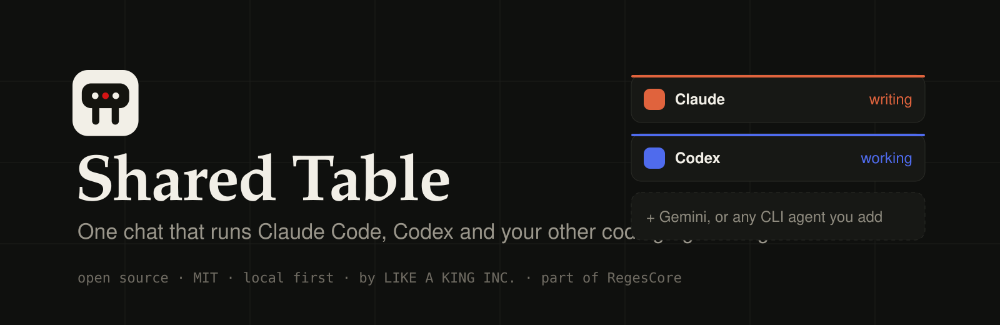
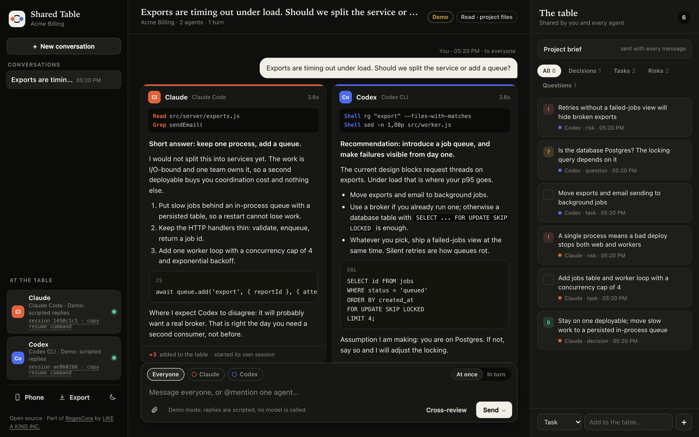
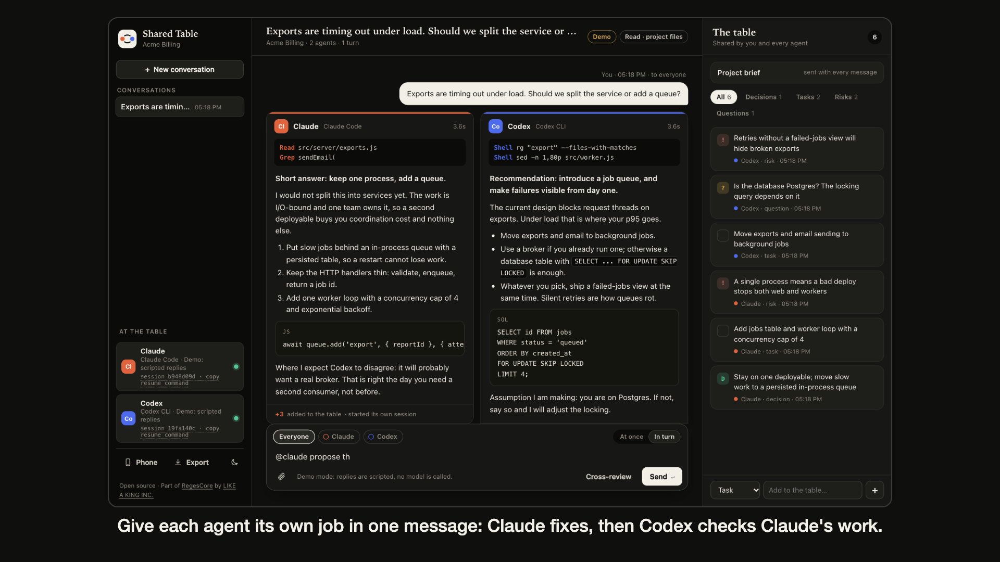
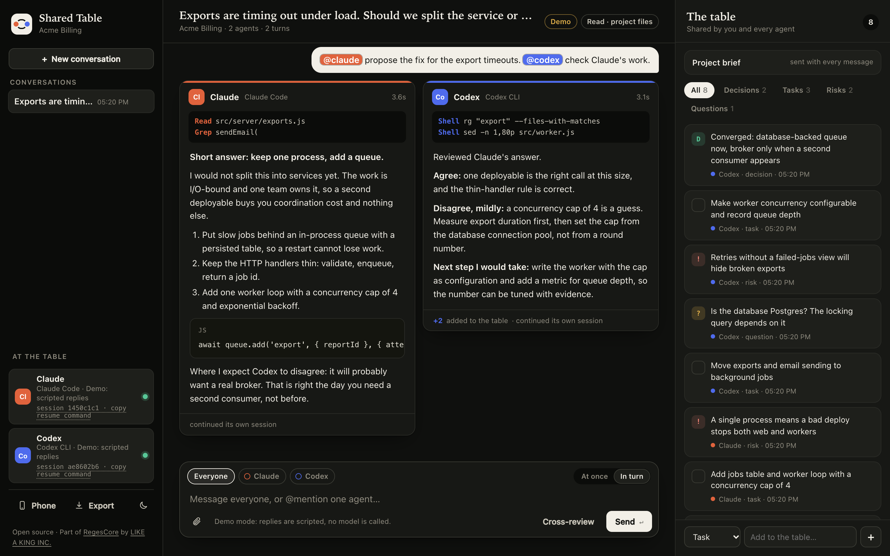
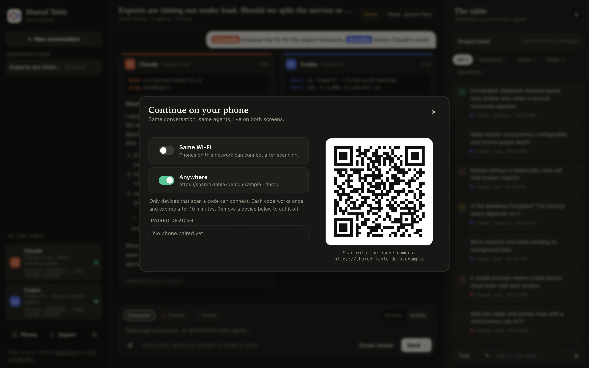
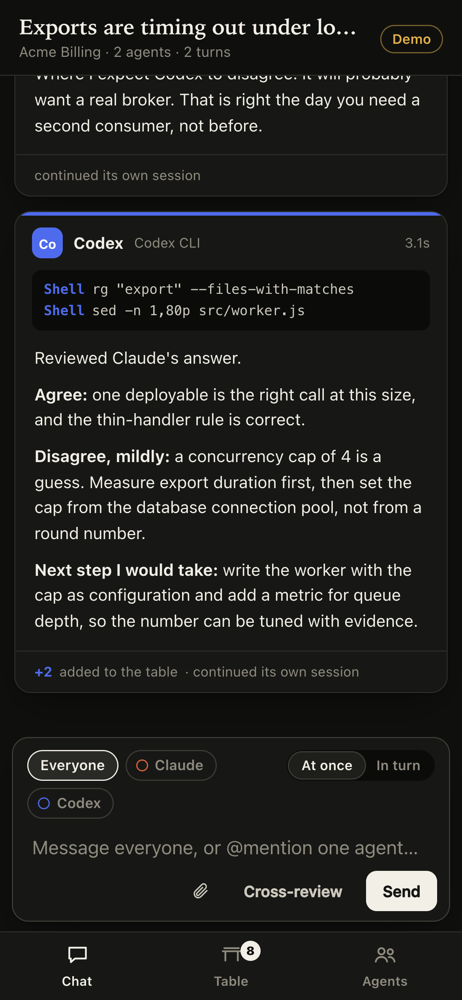
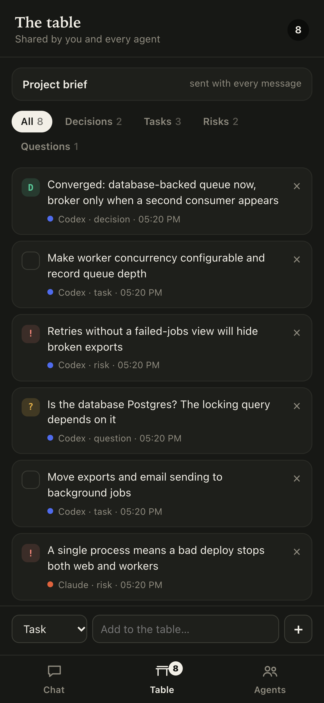
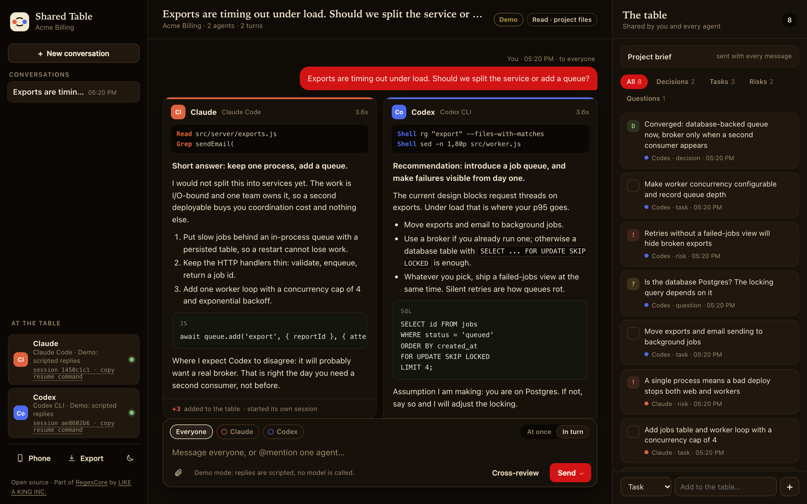
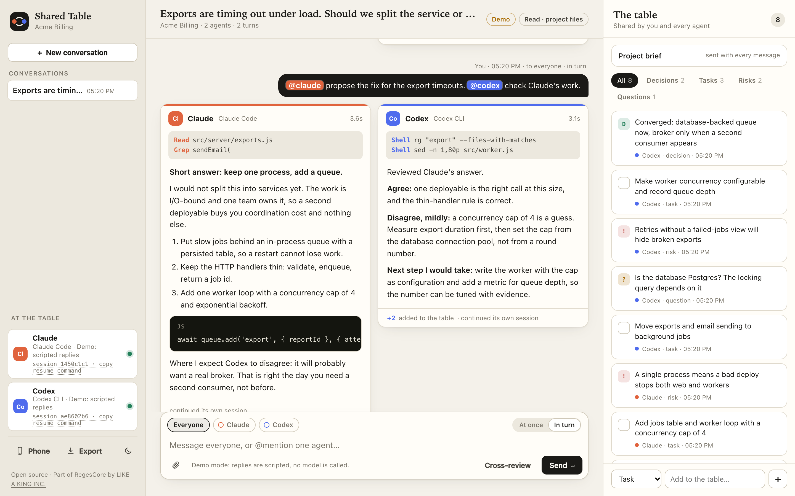
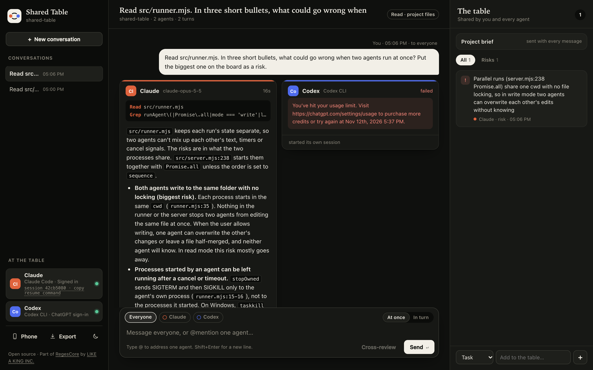

<p align="center">
  
</p>

<p align="center">
  <a href="LICENSE"></a>
  <a href="package.json"></a>
  <a href="package.json"></a>
  <a href="#agents"></a>
  <a href="#continue-on-your-phone"></a>
  <a href="#what-has-been-tested"></a>
</p>

<p align="center">
  <b>One chat that runs Claude Code, Codex and your other coding agents on the same project at the same time.</b><br>
  You supervise from one screen. Each agent works in its own real session. Decisions, tasks and risks land on a board everyone shares.
</p>

<p align="center">
  <a href="#quick-start">Quick start</a> ·
  <a href="#how-it-works">How it works</a> ·
  <a href="#agents">Agents</a> ·
  <a href="#continue-on-your-phone">Phone</a> ·
  <a href="#configuration">Configuration</a> ·
  <a href="docs/ROADMAP.md">Roadmap</a> ·
  <a href="SECURITY.md">Security</a>
</p>

<br>

<p align="center">
  
</p>

<p align="center"><sub>Actual interface, captured in Chrome. This screenshot uses demo mode, so the two replies are scripted. A run with real agents is shown under <a href="#what-has-been-tested">What has been tested</a>.</sub></p>

## Overview

If you use more than one coding agent, you already know the routine: paste the task into Claude Code, paste it again into Codex, carry one agent's answer to the other, and keep the decisions in your head.

Shared Table is a bridge. You type once. Every agent you addressed starts working, each in its own process and its own session, with its own tools. You watch them side by side, stop them, set one against the other, and keep what matters on a shared board. Nothing is hosted: it runs on your machine and uses the CLIs and sign-ins you already have.

- **One message, many agents.** No mention sends to everyone. `@claude`, `@codex` or `@gemini` addresses one.
- **Not only CLIs.** Local models in LM Studio or Ollama, and any OpenAI-compatible API server, sit at the same table.
- **Different jobs in one message.** "`@claude` fix the timeout. `@codex` check Claude's work." Send it **in turn** and Codex starts after Claude finishes, with Claude's result in hand.
- **Real sessions, not copies.** Each agent keeps its own CLI session per conversation. Copy the resume command from the sidebar and open the same session in Claude Code or Codex.
- **A shared table.** Agents post decisions, tasks, risks and open questions to a board. You can add, tick off and remove entries. Every agent sees the board with every message.
- **Cross-review.** One click asks each agent to review the others' last answers and converge on one plan.
- **Three levels of trust.** `advise` (no tools), `read` (agents can read your project), `build` (agents can edit files and run commands).
- **Files and images.** Paste, drop or attach screenshots and files in the chat. Text files travel inside the prompt; images go to Claude Code, Codex and vision-capable API models.
- **Organised.** Rename, pin and group conversations. Five themes and six accent colours.
- **Your phone, same chat.** Scan a QR code and continue on your phone, on the same Wi-Fi or from anywhere.

## Demo

<p align="center">
  <a href="docs/assets/shared-table-demo.mp4"></a>
</p>

<p align="center"><sub>Click to play the 41-second walkthrough (<a href="docs/assets/shared-table-demo.mp4">docs/assets/shared-table-demo.mp4</a>). Recorded in demo mode: the agent replies in the video are scripted.</sub></p>

## Quick start

You need [Node.js](https://nodejs.org) 20 or newer and at least one agent CLI, signed in:

| Agent | Install | Sign in |
|---|---|---|
| Claude Code | [code.claude.com/docs](https://code.claude.com/docs/en/quickstart) | `claude auth login` |
| Codex | `npm install -g @openai/codex` | `codex login` |
| Gemini CLI (optional) | `npm install -g @google/gemini-cli` | run `gemini` once |

Then start Shared Table in your project:

```bash
git clone https://github.com/iboss21/shared-table.git
cd shared-table
node bin/shared-table.mjs /path/to/your/project
```

Open **http://127.0.0.1:4783**. There is nothing to `npm install`: the project has no dependencies.

To install the `shared-table` command instead:

```bash
npm install -g github:iboss21/shared-table
shared-table /path/to/your/project --mode read
```

No accounts yet? Try the interface with scripted stand-in agents:

```bash
node bin/shared-table.mjs --demo
```

## How it works

```
                          you (the supervisor)
                                  │
                     one message, @mentions optional
                                  │
                    ┌─────────────▼──────────────┐
                    │        Shared Table        │   127.0.0.1:4783
                    │  brief · board · transcript│   + paired phones
                    └───┬──────────┬──────────┬──┘
                        │          │          │       one process per agent,
                  ┌─────▼───┐ ┌────▼────┐ ┌───▼─────┐  each in its own CLI session
                  │ claude  │ │  codex  │ │ gemini… │
                  └─────┬───┘ └────┬────┘ └───┬─────┘
                        │          │          │
                        └────── your project folder ──────┘
```

1. **You send a message.** Shared Table works out who it is for: everyone, or the agents you mentioned.
2. **Each agent gets the same package:** the project brief, the shared board, the recent transcript including what the *other* agents said, and your request. Agents cannot see each other's sessions, only what was written in the chat and what is in the project folder. The chat is the bridge.
3. **Each agent runs as its own process** through its official CLI in non-interactive mode. Output streams into its card as it arrives, with the files it reads and the commands it runs.
4. **Replies end with an optional `board` block.** Shared Table lifts those entries onto the board and shows the rest as the answer.
5. **Sessions persist.** The first message starts a session per agent; later messages resume it, so an agent keeps its own working memory. The sidebar shows each session id with a command that opens it in the agent's own CLI.

### At once, or in turn

| Mode | What happens | Use it for |
|---|---|---|
| **At once** | Every addressed agent starts immediately. | Two opinions on the same question; splitting independent work. |
| **In turn** | Agents go in the order you mentioned them. Each one receives what the earlier ones finished in this turn. | "Claude, fix it. Codex, check Claude's work." |
| **Cross-review** | Each agent gets the others' last answers and is asked to agree, disagree and converge. | Settling a disagreement before you decide. |

### Modes

| Mode | Agents can | Start with |
|---|---|---|
| `advise` (default) | Answer. No tools, no file access. | `shared-table` |
| `read` | Read files in the project folder. | `shared-table --mode read` |
| `build` | Edit files and run commands in the project folder, using each agent's full harness (project instructions, your settings). | `shared-table --mode build` |

In `build` mode every agent works in the same folder. They are told who else is at the table, to say which files they take and never to undo each other's work, but nothing enforces it. Commit before you start, and review the diff after.

<p align="center">
  
</p>

## Files and images

Paste from the clipboard, drop onto the chat, or use the paperclip. Up to 10 files per message, 15 MB each.

| File | How it reaches the agents |
|---|---|
| Text and code (up to 200 KB) | Included in full in the prompt, for every agent. |
| Images (PNG, JPEG, GIF, WebP) | Claude Code opens them with its Read tool; Codex receives them with `--image`; API agents receive them in the OpenAI vision format. |
| Anything else (PDF and so on) | Saved next to the conversation and handed over by path. Claude Code can open it in any mode; other agents need `read` or `build` mode. |

Links are sent as text. In `advise` mode agents have no web access, so they see the address, not the page.

## Agents

| Agent | CLI | Status |
|---|---|---|
| `claude` | [Claude Code](https://code.claude.com/docs/en/headless) | Tested with real requests in all three modes, including session resume. |
| `codex` | [Codex CLI](https://learn.chatgpt.com/docs/non-interactive-mode) | Starts, authenticates and reports errors correctly. Model replies NOT TESTED at release. See below. |
| `gemini` | Gemini CLI | Experimental, NOT TESTED. Seated automatically when `gemini` is on your PATH. |
| `lmstudio`, `ollama` | Local models over their OpenAI-compatible API | Protocol tested against a stand-in server. NOT TESTED against the real apps. |
| any API server | An OpenAI-compatible `/v1/chat/completions` endpoint: llama.cpp, vLLM, RegesARC, a hosted gateway | Same adapter; add it under `customAgents` with a `baseUrl`. |
| any other CLI | your command | Add it under `customAgents` with a `command`. |

By default the table seats Claude and Codex, plus Gemini when its CLI is installed. Choose explicitly with `--agents claude,codex,gemini`.

### Add your own agent

Any command that takes a prompt and prints an answer can sit at the table. Put this in `shared-table.config.json` in your project folder:

```json
{
  "agents": ["claude", "codex", "local"],
  "customAgents": [
    { "id": "local", "label": "Local model", "command": "ollama", "args": ["run", "llama3.1", "{prompt}"] }
  ]
}
```

`{prompt}` is replaced with the instructions and the shared context. Leave it out and the prompt is written to the command's standard input instead. Address the agent as `@local`.

### Local models and API servers

Anything that serves the OpenAI chat-completions API can sit at the table next to the CLI agents. LM Studio and Ollama have presets:

```bash
shared-table --agents claude,codex,lmstudio
```

For any other server, give it a `baseUrl`:

```json
{
  "agents": ["claude", "codex", "reges"],
  "customAgents": [
    { "id": "reges", "label": "Reges", "baseUrl": "http://127.0.0.1:8080/v1", "model": "", "apiKeyEnv": "REGES_API_KEY" }
  ]
}
```

Leave `model` empty to use the first model the server lists. If the server needs a key, put the *name* of an environment variable in `apiKeyEnv`; the key itself never goes in the file. API agents answer from the brief, the board and the transcript only: they have no tools and no file access in any mode, and no session of their own.

## Continue on your phone

<p align="center">
  
  &nbsp;
  
  &nbsp;
  
</p>

Choose **Phone** in the sidebar, switch on a connection, scan the code. The phone opens the same conversation, live: messages you send from either screen appear on both.

| Connection | How | Notes |
|---|---|---|
| **Same Wi-Fi** | The server also listens on this computer's network address. | Plain HTTP on your local network. |
| **Anywhere** | A private HTTPS tunnel: [cloudflared](https://developers.cloudflare.com/cloudflare-one/connections/connect-networks/downloads/) if installed, otherwise an `ssh` tunnel through localhost.run. Free, no account. | Works on mobile data. The tunnel provider carries your traffic. |
| **Your own address** | `--public-url https://…` and forward it to the printed phone port. | For Tailscale, your own reverse proxy and similar. |

Only a device that scans a code can connect. A code works once and expires after ten minutes. A paired phone can chat, stop a run and edit the board; it cannot change phone access or delete conversations. Remove a device in the same dialog to cut it off. On the phone, "Add to Home Screen" gives you a full-screen app icon.

## Themes

Five themes (Day, Night, Crimson, Parchment, Midnight) and six accent colours, from the moon button in the sidebar. The choice is kept per browser.

<p align="center">
  
  
</p>

## Configuration

Settings come from, in rising priority: defaults, `shared-table.config.json` in the project folder, `SHARED_TABLE_*` environment variables, command-line flags. A commented example is in [shared-table.config.example.json](shared-table.config.example.json).

| Flag | Meaning | Default |
|---|---|---|
| `[project-folder]` | The project the agents work in. | current folder |
| `--mode advise\|read\|build` | What agents are allowed to do. | `advise` |
| `--agents a,b,c` | Who sits at the table. | `claude,codex` (+ `gemini` if installed) |
| `--sessions native\|stateless` | Keep one CLI session per agent per conversation, or start fresh every turn. | `native` |
| `--name`, `--brief` | Project name and the brief sent with every message. | folder name |
| `--port` | Local port. | `4783` |
| `--lan`, `--tunnel`, `--public-url` | Phone access at start-up. | off |
| `--claude-path`, `--codex-path`, `--gemini-path` | Executable locations when not on PATH. | auto-detected |
| `--claude-model`, `--codex-model`, `--gemini-model` | Model passed to each CLI. | each CLI's default |
| `--timeout <seconds>` | Per-agent time limit. | 180 / 420 / 900 by mode |
| `--allow-api-keys` | Keep API-key environment variables. Without it they are removed, so each CLI uses its own sign-in. | off |
| `--data-dir` | Where conversations are saved. | `~/.shared-table/projects/<project>` |
| `--demo` | Scripted agents; no CLI or account needed. | off |

Run `shared-table --help` for the full list.

## What has been tested

Stated plainly, because an agent bridge that overstates itself is worse than none.

| Area | Result at release 0.1.0 |
|---|---|
| Claude Code 2.1.321, macOS 13 (Intel), Node 22 | **Tested with a real account:** `advise`, `read` (read a project file), `build` (created a file), and session resume (recalled a word from the previous turn). |
| Codex CLI 0.167.1 | **Partly tested:** discovery, sign-in check, every flag accepted, thread started, provider error shown in the chat. **Model replies, tool events and session resume are NOT TESTED:** the test account had reached its usage limit. |
| Both agents in one real turn | Tested: Claude answered while Codex returned its usage-limit error in the same turn, and neither blocked the other (screenshot below). |
| Gemini CLI, custom CLI agents | Argument building is unit-tested. Real runs NOT TESTED. |
| API agents (LM Studio, Ollama, other OpenAI-compatible servers) | Streaming, key handling and failure reporting tested against a local stand-in server. NOT TESTED against LM Studio, Ollama or RegesARC themselves. |
| Attachments | **Tested with real Claude Code:** it described an attached image and quoted an attached text file. Codex `--image` and API vision input are NOT TESTED. |
| Phone pairing | Tested in a browser at phone size over the Wi-Fi listener and the phone listener, and the QR code was decoded by Chrome's barcode reader. NOT TESTED on a physical phone. |
| Tunnels (cloudflared, localhost.run) | NOT TESTED. The pairing and permission logic behind them is covered by tests with a stand-in tunnel. |
| Windows, Linux | NOT TESTED. |
| Claude or Codex desktop apps listing a session started here | Unverified. Opening the session with the copied CLI resume command is the supported path. |

<p align="center">
  
</p>

<p align="center"><sub>A real run, not demo mode: Claude Code read <code>src/runner.mjs</code> and answered; Codex returned its account's usage limit, shown as-is.</sub></p>

```bash
npm test     # 14 tests, mock agents, no model requests
```

## Limits worth knowing

- The agents' own account limits, prices and terms apply. Shared Table never signs in for you, buys credits or falls back to an API key.
- Every message you send goes, with the brief, the board and recent transcript, to the provider behind each agent you address. Do not paste secrets.
- One turn runs at a time. A conversation holds 200 turns; the last 12 are sent as shared context.
- In `build` mode two agents can edit the same folder at once. That is the feature, and the risk.
- Conversations are stored unencrypted on your disk under `~/.shared-table/`.

## Repository map

```
bin/shared-table.mjs     command-line entry
src/server.mjs           HTTP server, turns, board, sessions, phone pairing
src/agents.mjs           agent registry: Claude Code, Codex, Gemini, API servers, custom commands
src/runner.mjs           starts one agent process and streams its output
src/board.mjs            the shared board format
src/remote.mjs           Wi-Fi addresses and tunnels
src/qr.mjs               dependency-free QR code encoder
src/demo.mjs             scripted agents for demo mode
public/                  the interface: one HTML file, one stylesheet, one script
test/                    node:test suite
scripts/capture.mjs      regenerates the screenshots and the demo video
```

## Where it came from

Shared Table began as two small private tools written for one project: a local page that sent the same message to Codex and Claude and showed both answers. This repository merges them and makes the idea general: any project, any number of agents, real sessions, a shared board, and a phone.

## Roadmap

Next up: approvals in the chat, per-agent stop, a changes panel with one git worktree per agent, and a terminal panel. The full plan is in [docs/ROADMAP.md](docs/ROADMAP.md).

## Contributing and security

Pull requests are welcome; see [CONTRIBUTING.md](CONTRIBUTING.md). The trust model, and how to report a vulnerability, are in [SECURITY.md](SECURITY.md).

## License

Released under the [MIT License](LICENSE), Copyright (c) 2026 LIKE A KING INC.

Claude and Claude Code are trademarks of Anthropic. Codex is a trademark of OpenAI. Gemini is a trademark of Google. Shared Table is an independent project: it starts the CLIs you installed and is not affiliated with or endorsed by any of them.

<div align="center">

<br>

| | |
|---|---|
| Product | Shared Table, part of [RegesCore](https://regescore.pro) |
| Publisher | [LIKE A KING INC.](https://likeakinginc.com) |
| Developer | Davidio / Dev: [davidio.dev](https://davidio.dev) |
| Source | [github.com/iboss21/shared-table](https://github.com/iboss21/shared-table) |

If Shared Table saves you a round of copy and paste, a star helps other builders find it.

</div>
